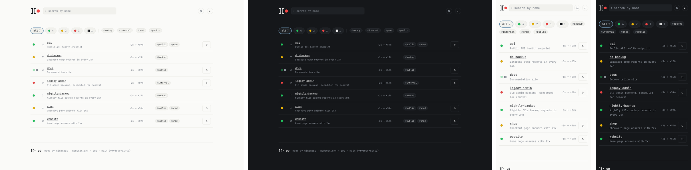

A minimal alternative to [Uptime Kuma](https://github.com/louislam/uptime-kuma): HTTP, Prometheus and push checks, notifications and status pages, configured in plain `key = value` files.

- **One static binary**, Go standard library only ([go.mod](go.mod)), in the spirit of [nobloat.org](https://nobloat.org)
- **No database**: one append-only CSV audit log per monitor
- **Config as code**: one file per monitor, notifier and status page, checked with `up -check`, reloaded on change



## Features

| | |
|---|---|
| [HTTP checks](#http-options) | status codes, body regex, JSON match, headers, basic auth, redirects, TLS expiry |
| [Prometheus checks](#monitors) | one metric of a [`/metrics`](https://prometheus.io/docs/instrumenting/exposition_formats/) endpoint, or a [PromQL](https://prometheus.io/docs/prometheus/latest/querying/api/#instant-queries) query (Thanos, Mimir, VictoriaMetrics work too) |
| [Push monitors](#push-monitors) | dead man switch for cron jobs and backups; [Uptime Kuma](https://github.com/louislam/uptime-kuma) and [healthchecks.io](https://healthchecks.io/docs/http_api/) compatible URLs |
| [Notifications](#notifiers) | Slack / Mattermost webhooks, mail, [ilert](https://www.ilert.com); reminders while red |
| [Status pages](#status-pages) | public, per tag, custom templates |
| Web UI | live updates, filters, search, keyboard shortcuts, pause with reason and end, dark mode, phone friendly, installable on the home screen |
| Heartbeat | pings an external URL so something notices when `up` itself is down |

**Not included:** editing monitors in the UI (the files are the source of truth), graphs, users and roles.

## Deployment

[`compose.yaml`](example/compose.yaml) with [Caddy](https://caddyserver.com) for TLS:

```yaml
services:
  up:
    image: ghcr.io/nobloat/up:latest
    restart: unless-stopped
    environment: {TZ: Europe/Vienna}
    volumes: [./config:/config:ro, ./data:/data]
  caddy:
    image: caddy:2
    restart: unless-stopped
    ports: ["80:80", "443:443", "443:443/udp"]
    volumes: [./Caddyfile:/etc/caddy/Caddyfile:ro, caddy:/data]
volumes:
  caddy:
```

`Caddyfile`:

```
up.nobloat.org {
	reverse_proxy up:7493
}
```

- `./data` must be writable by uid 65534: `sudo chown 65534:65534 data`
- `up -check -config <dir>` validates a config, e.g. in CI (exit code 1 on any error)
- A damaged audit log stops startup instead of being reset: back it up and repair it

## Configuration

A directory (`-config`, `/config` in the image): `up.conf` plus one file per entity, named `<name>.<kind>.conf`. Start from [`example/config`](example/config), or see [`config`](config) for every feature (`make run`).

```
config/
  up.conf
  website.monitor.conf
  prod/api.monitor.conf
  ops-chat.notifier.conf
  public.page.conf
```

- One `key = value` per line, `#` starts a comment, lists are comma separated, nested keys are dotted (`headers.X-Api-Key`)
- Durations: [Go syntax](https://pkg.go.dev/time#ParseDuration) plus days (`30s`, `1h`, `7d`, `1d12h`)
- Unknown keys are errors. A broken entity file is skipped and logged; only a broken `up.conf` stops startup
- The directory holds credentials: treat it as secret

### up.conf

```ini
listen = :7493
base_url = https://up.nobloat.org
data_dir = /data
auth.user = admin
auth.password = secret
heartbeat.urls = https://hc-ping.com/<uuid>
```

| Option | Default | |
|---|---|---|
| `base_url` | required | public URL, for links in notifications |
| `data_dir` | required | audit logs |
| `auth.user`, `auth.password` | required | basic auth for the UI and API |
| `listen` | `:7493` | plain HTTP, put a TLS proxy in front |
| `proxy` | | HTTP proxy for all checks and notifications |
| `evaluation_interval` | `30s` | how often notifications are evaluated and batched |
| `heartbeat.urls`, `heartbeat.interval` | `1m` | URLs to GET while `up` runs |

### Monitors

```ini
type = http
description = Home page answers with 2xx
tags = public
interval = 1m
retry_count = 2
notifiers = ops-chat
url = https://example.com/health
cert_min_valid_days = 14
```

| Type | Checks | Options |
|---|---|---|
| `http` | an HTTP(S) endpoint | [HTTP options](#http-options) |
| `metric` | one metric of a [Prometheus text format](https://prometheus.io/docs/instrumenting/exposition_formats/) endpoint | HTTP options, `metric`, `labels.<name>`, `value` (`< 80`, ops `> >= < <=`); every matching series must pass, none fails |
| `promql` | an [instant query](https://prometheus.io/docs/prometheus/latest/querying/api/#instant-queries); `url` is the API base | HTTP options, `query`, `value`; every series must pass, empty fails |
| `push` | something reports in | `token` (16+ characters, unique), see [push monitors](#push-monitors) |

| Option | Default | |
|---|---|---|
| `type`, `interval` | required | `interval`: between checks, or expected between pushes |
| `description` | | public, shown on status pages |
| `tags` | | UI filters and status pages |
| `retry_count` | `0` | failures after the first before red; yellow until then |
| `retry_interval` | `interval` | between checks while yellow |
| `timeout` | `10s` | per check |
| `grace` | | `push` only: extra time before a missing push fails |
| `notifiers` | | notifier names; unknown ones are skipped and logged |

#### HTTP options

For `http`, `metric` and `promql` (`promql` always uses `GET`).

| Option | Default | |
|---|---|---|
| `url` | required | |
| `method` | `GET` | `GET`, `POST`, `HEAD` |
| `headers.<name>` | | `Host` overrides the host header |
| `basic_auth.user`, `basic_auth.password` | | |
| `body` | | request body |
| `accepted_status` | any 2xx | e.g. `200, 204` |
| `body_regex` | | [RE2 syntax](https://github.com/google/re2/wiki/Syntax) |
| `json_match.path`, `json_match.equals` | | `data.0.status` = `ok`; `1` is a number, `"1"` a string |
| `max_redirects` | `10` | |
| `skip_verify` | `false` | skip TLS verification |
| `cert_min_valid_days` | | red without retries when the certificate expires sooner |

- Redirects never downgrade HTTPS. With credentials, headers, a body or a query string only same-origin redirects are followed
- Secrets are masked on the detail page; errors never contain the URL

### Push monitors

```sh
curl -fsS https://up.nobloat.org/push/backup/<token>
curl -fsS -d '{"files": 12}' "https://up.nobloat.org/push/backup/<token>?status=down"

curl -fsS "https://up.nobloat.org/api/push/<token>?status=down&msg=disk%20full"

some-job > job.log 2>&1; rc=$?; curl -fsS --data-raw "$(tail -c 4000 job.log)" https://up.nobloat.org/ping/<token>/$rc
```

No push within `interval` + `grace` is a failure; the token is the only auth.

### Notifiers

Sent when a monitor turns red or recovers, batched every `evaluation_interval`. Failed deliveries retry, also after a restart.

```ini
type = webhook
url = https://chat.example.com/hooks/xyz
reminder_interval = 1h
```

| Type | Options |
|---|---|
| `webhook` | `url`, `headers.<name>`; [Slack](https://api.slack.com/messaging/webhooks) / [Mattermost](https://developers.mattermost.com/integrate/webhooks/incoming/) format |
| `smtp` | `host`, `port`, `tls` (`starttls` · `tls` · `none`), `user`, `password`, `from`, `to`, `subject_prefix` (`[up]`) |
| `ilert` | `integration_key` of an "API" alert source; red opens an alert, recovery resolves it |

All but `ilert` take `reminder_interval`; ilert escalates on its own.

### Status pages

`public.page.conf` serves `/status/public` with every monitor tagged `public`:

```ini
title = Example Status
tag = public
```

`template` points to a custom [`html/template`](https://pkg.go.dev/html/template) (relative to the config directory) receiving `StatusPage{Title, State, Monitors}`, e.g. [`config/templates/minimal.html`](config/templates/minimal.html).

## Development

```sh
make run
make mailpit
make test
make build
make package
make screenshots
```
